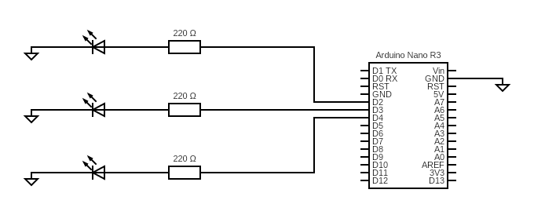
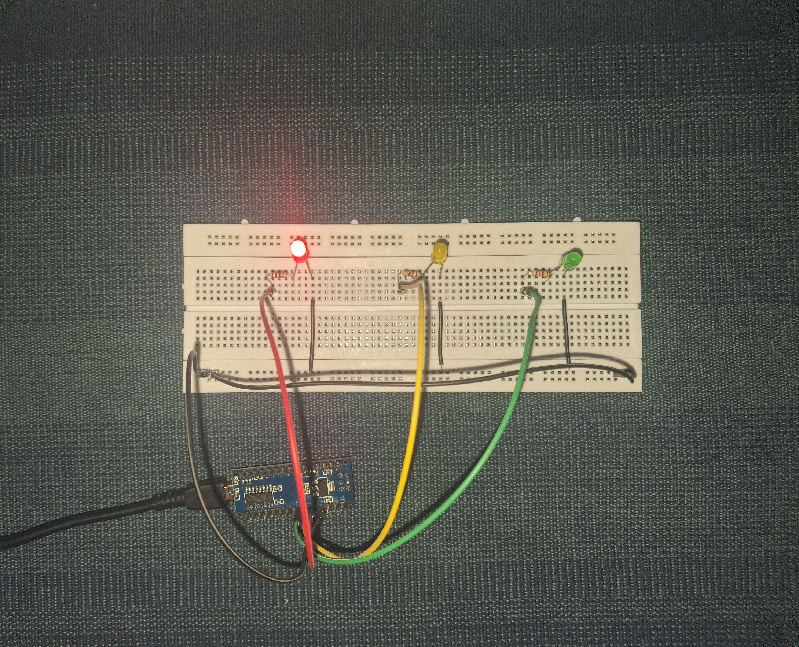
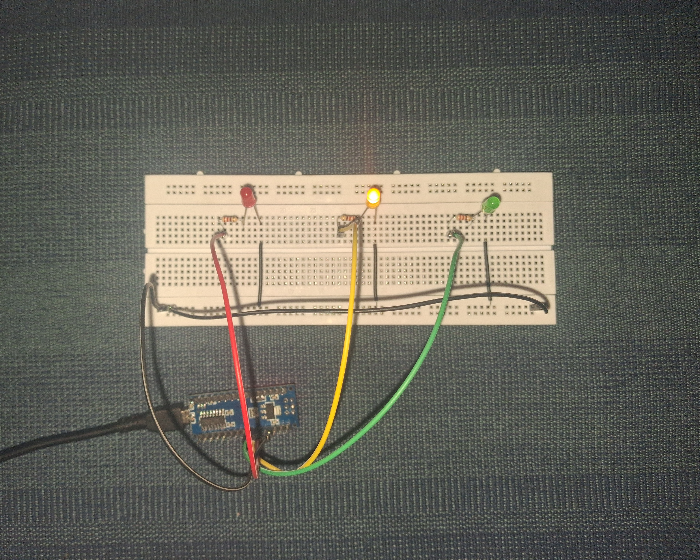
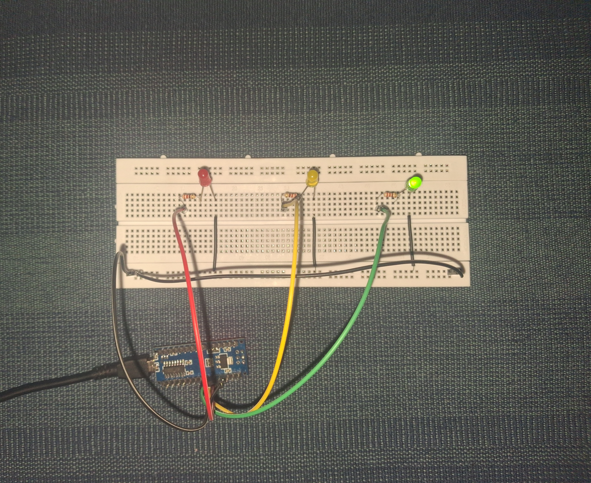

# Arduino Traffic Light 🚦

A minimal Arduino project that simulates a real-world traffic light sequence using three LEDs. 

## Images

### Circuit Diagram

### Working Prototype

  
  
  

## How I Made It

### 1. The Hardware Setup
I built a simple circuit on a breadboard using standard components:
* 1x Arduino Nano R3
* 3x LEDs (Red, Yellow, Green)
* 3x 220Ω Resistors (to prevent the LEDs from burning out)
* Jumper wires

**The Wiring:**
* **Red LED** positive leg connected to a 220Ω resistor, which then routes to **Pin D2**.
* **Yellow LED** positive leg connected to a 220Ω resistor, which then routes to **Pin D3**.
* **Green LED** positive leg connected to a 220Ω resistor, which then routes to **Pin D4**.
* All negative legs (cathodes) share a common ground connection that routes back to the Arduino Nano's **GND**.

### 2. The Code Logic
The sketch (`TrafficLight/TrafficLight.ino`) relies on a basic state-machine loop. 

In the `setup()` block, pins 2, 3, and 4 are declared as `OUTPUT`. In the `loop()` block, I used `digitalWrite(pin, HIGH/LOW)` and `delay(milliseconds)` to create the following sequence:
1. **Green ON** (Traffic flows)
2. **Yellow ON** (Prepare to stop)
3. **Red ON** (Stop)
4. Repeat.

## How to Run It
1. Clone this repository and keep the folder structure intact.
2. Open `TrafficLight/TrafficLight.ino` in the Arduino IDE.
3. Connect your Arduino board via USB.
4. Select your board and port under the **Tools** menu.
5. Click **Upload**.
